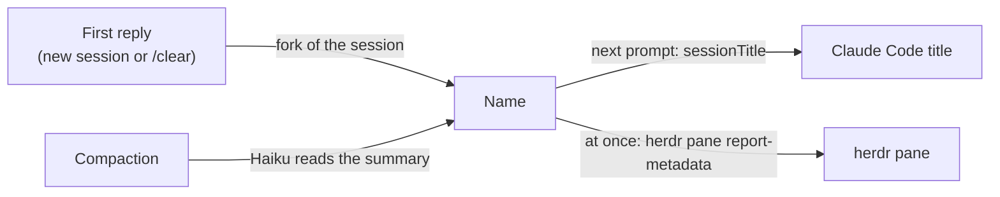

# session-topic

Names each Claude Code session after what it is about, and shows that name in your [herdr](https://herdr.dev) panes.
Claude Code titles a session from its first prompt and keeps that title; session-topic renames it after the first reply, after the first reply that follows each `/clear`, and after each compaction.
Install it with one command, then use Claude Code as usual.

## Install

At the Claude Code prompt:

```
/plugin install session-topic --marketplace zcharef/session-topic
```

Answer `y` to add the marketplace, then pick a scope. From a shell, the same thing:

```sh
claude plugin install session-topic --marketplace zcharef/session-topic
```

With herdr, this installs the Claude Code plugin for you:

```sh
herdr plugin install zcharef/session-topic
```

It needs Claude Code on your `PATH`. The herdr plugin also adds an action, "Install/update the Claude Code plugin", to update later.

## What it does

- After the first reply of a new session, or of a conversation started with `/clear`, it gives the session a short name (it asks the model for 3 to 6 words) in the language you write in: "Fix flaky upload retries" for one session, "Différence entre mutex et sémaphore" for another.
- After each compaction, it names the session again from the compaction summary, so the name follows the work as it moves.
- A resumed session keeps the name it has. One that has none is named after its next reply.
- Subagents, and the messages they hand back, never rename anything.
- `claude -p` runs make no model call. One started from inside a Claude Code session (by a script or a tool) never touches that session's herdr pane.

Claude Code takes the new name as the session title at your next prompt, and sets it as the terminal title. herdr shows it right away, in the sidebar where it would say `claude`, and on the pane border unless you had labelled the pane before the name arrived. A label you add later shows once the session is renamed (after a `/clear` or a compaction). The name leaves the pane when Claude Code exits.

## How it works

session-topic is a Claude Code mod: a hooks module that Claude Code runs inside the session.



The naming call starts after the turn has ended, so it never delays a reply. In one test session it took about one second.

## Auth and cost

It uses whatever Claude Code is signed in with: your Pro/Max subscription by default, or an API key if you run Claude Code with one. There is nothing to configure, and the plugin has no key of its own.

Each conversation costs one fork on your session's model (two if the first gives no usable name), and each compaction costs one Haiku call. In one test session on Claude Code 2.1.300, the fork read about 28K tokens from the prompt cache and produced 16 output tokens; the Haiku call read 1.2K tokens and produced 17. On a subscription this counts against your usage; with an API key it is billed at the usual rates.

## What is sent to the model

- The fork re-sends the session's own transcript, the same one each turn already sends, plus a short question asking for a title.
- After a compaction, Haiku receives the compaction summary.

Both go through your Claude Code session to your own Claude account. The plugin has no server and makes no network call of its own. Inside herdr (when `HERDR_ENV=1`), it runs two local commands on its own pane: `herdr pane get` to see whether you labelled the pane, and `herdr pane report-metadata` to show the name.

## Compatibility

| Where | Status |
|---|---|
| Claude Code 2.1.300, macOS | Tested |
| Claude Code on Linux, desktop app | Not tested |
| herdr 0.9.0 | Tested: sidebar and pane border |
| iTerm2, Ghostty, WezTerm | Should work through the terminal title Claude Code sets. Not tested. |
| tmux | Not tested. To show the title on pane borders, add the two lines below to `~/.tmux.conf`. |

```tmux
set -g pane-border-status top
set -g pane-border-format "#{pane_title}"
```

## Limits

- Where an organization manages Claude Code (managed settings), hooks from plugins you install yourself do not run. Only plugins the organization lists do.
- Claude Code's own title changes one prompt late: a plugin can hand Claude Code a new title only when you submit a prompt. herdr is updated at once.
- A title you set with `/rename` lasts until session-topic names the session again: after its first reply if it had no name yet, after a `/clear`, or after a compaction.
- Claude Code mods are in early access: the API may change between releases.

## Uninstall

```sh
claude plugin uninstall session-topic@session-topic
claude plugin marketplace remove session-topic
```

With herdr, also run `herdr plugin uninstall zcharef.session-topic`.

## Development

```sh
claude --plugin-dir .                  # run it; edits reload on save
claude plugin test .                   # unit tests
claude plugin validate --strict .      # manifest and hooks
tsc -p .                               # types, written by the first --plugin-dir run
```

Bump `version` in `.claude-plugin/plugin.json` and `herdr-plugin.toml` for each release, so `claude plugin update` picks up the change.

Run Claude Code with `--debug` to see the plugin's log lines (`"event":"named"`, `"herdr_failed"` and the rest).

## License

[MIT](LICENSE)
